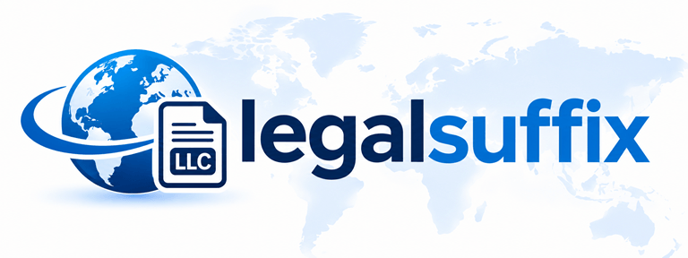

# legalsuffix


[](https://pypi.org/project/legalsuffix/)
[](https://www.python.org/)
[](LICENSE)

Detect, normalize, and strip legal entity suffixes (LLC, LTD, GmbH, OOO, 株式会社…) in 20+ languages. Parse company names safely.

# Operations

The package exposes these operations from `legalsuffix`. Country and language
filters are optional; country codes use ISO 3166-1 alpha-2 and language codes use
ISO 639-1 two-letter codes.

```python
from legalsuffix import (
    get_suffixes,
    match_legal_suffix,
    normalize_legal_suffix,
    parse_company_name,
    strip_legal_suffix,
)
```

### Get suffix records

`get_suffixes` returns `LegalSuffix` records. Filters are optional.

```python
suffixes = get_suffixes(country_code="DE", language_code="de")
for suffix in suffixes[:5]:
    print(suffix.elf_code, suffix.entity_legal_form_name_local_name)
```

### Match a suffix

`match_legal_suffix` finds a legal form in the company name. Some registry names
place the legal form before additional descriptive text. It returns `None` if
there is no match. The end offset is exclusive.

```python
company = "Musterfirma GmbH"
match = match_legal_suffix(company, country_code="DE")
if match is not None:
    print(match.suffix)  # "GmbH"
    print(match.start_pos, match.end_pos)  # 12 16
    print(match.records[0].elf_code)  # ELF code for this legal form
```

### Normalize a suffix

Normalization trims surrounding whitespace, ignores punctuation and accents,
and lowercases the suffix.

```python
normalize_legal_suffix(" GmbH. ")  # "gmbh"
```

### Parse a company name

`parse_company_name` returns the company name with the matched legal form
removed, along with the optional suffix match. Text after the form is preserved.

```python
parsed = parse_company_name("Musterfirma GmbH", country_code="DE")
print(parsed.name)  # "Musterfirma"
if parsed.suffix is not None:
    print(parsed.suffix.suffix)  # "GmbH"
```

### Strip a suffix

`strip_legal_suffix` removes the recognized legal form and preserves any text
that follows it.

```python
strip_legal_suffix("Musterfirma GmbH", country_code="DE")  # "Musterfirma"
```

Country codes use ISO 3166-1 alpha-2, and language codes use ISO 639-1 two-letter
codes.

# Development hooks

Install the pre-commit hook to run the unit tests and refresh the coverage
badge before a commit that changes a Python file under `src/`:

```shell
uv run pre-commit install
```

If the badge changes, stage `README.md` and retry the commit so the updated
coverage is included.

# Data Source

ISO 20275: Entity Legal Forms Code List: [Entity Legal Forms Code List (Version 1.6 )](https://www.gleif.org/lei-data/code-lists/iso-20275-entity-legal-forms-code-list/2026-02-19-elf-code-list-v1.6.xlsx)
